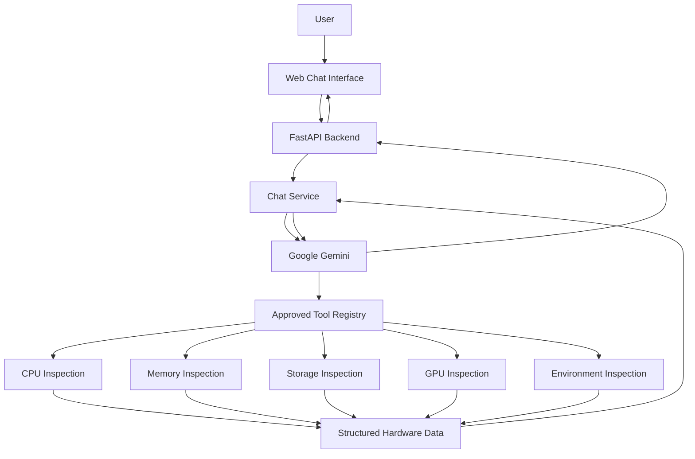

# Linux Hardware Assistant

An AI-powered Linux hardware Q&A assistant that inspects system hardware through safe, read-only system tools and uses Google Gemini to answer questions based on verified system information.

## Overview

The Linux Hardware Assistant allows users to ask natural-language questions about their computer.

It collects hardware information using predefined inspection tools, converts command output into structured data, and passes verified information to Gemini for explanation.

The application currently supports:

- CPU information
- RAM and memory usage
- Storage devices and partitions
- GPU information
- Linux distribution and kernel details
- WSL2 environment detection
- Follow-up questions using conversation history

## Architecture



## Technology Stack

| Component | Technology |
|---|---|
| Language | Python |
| Backend | FastAPI |
| AI Model | Google Gemini |
| AI SDK | Google Gen AI SDK |
| Frontend | HTML, CSS, JavaScript |
| Hardware Inspection | psutil, lscpu, lsblk, lspci |
| Testing | pytest |
| Environment | Ubuntu / WSL2 |

## Project Structure

```text
problem-2-linux-hardware-assistant/
│
├── app/
│   ├── ai/
│   │   ├── chat_service.py
│   │   └── tool_registry.py
│   │
│   ├── services/
│   │   └── hardware_service.py
│   │
│   └── tools/
│       ├── cpu.py
│       ├── memory.py
│       ├── storage.py
│       ├── gpu.py
│       └── environment.py
│
├── frontend/
│   ├── index.html
│   └── script.js
│
├── tests/
│   └── test_tool_registry.py
│
├── .env
├── .gitignore
└── README.md
```

## How It Works

1. The user submits a hardware-related question.
2. The chat service sends the question to Gemini.
3. Gemini can request an approved hardware inspection tool.
4. The tool registry validates the requested tool.
5. The selected tool collects system information using predefined, read-only commands.
6. The result is returned as structured data.
7. Gemini explains the collected information in natural language.
8. The response is displayed in the web chat interface.

## Safety and Security

The application follows a restricted tool-execution design.

- Only predefined tools are registered.
- Unknown tool names are rejected.
- Arbitrary shell commands are not accepted from the AI.
- Hardware inspection uses fixed, read-only commands.
- Subprocess execution uses `shell=False`.
- Command execution includes timeouts.
- Tool failures are handled without exposing internal exception details.
- API credentials are stored in environment variables rather than source code.

## Environment Detection

The application identifies the Linux environment and detects WSL2.

When running inside WSL2, hardware readings may represent virtualized resources exposed to Linux rather than the complete physical hardware installed in the Windows computer.

The application communicates this limitation to users to avoid presenting virtualized information as confirmed physical hardware specifications.

## Requirements

- Python 3.11 or newer
- Ubuntu or another supported Linux distribution
- Google Gemini API key
- Git
- Required system utilities:
  - lscpu
  - lsblk
  - lspci

## Installation

Clone the repository:

```bash
git clone YOUR_REPOSITORY_URL
cd AI-Engineering-Assignment/problem-2-linux-hardware-assistant
```

Create a virtual environment:

```bash
python3 -m venv venv
```

Activate it:

```bash
source venv/bin/activate
```

Install dependencies:

```bash
pip install fastapi uvicorn pydantic psutil python-dotenv google-genai pytest
```

Install system utilities on Ubuntu:

```bash
sudo apt update
sudo apt install pciutils util-linux procps
```

## Configuration

Create a `.env` file in the project root:

```env
GEMINI_API_KEY=your_gemini_api_key
GEMINI_MODEL=gemini-3.5-flash-lite
```

Replace the example API key with your own key.

Never commit your `.env` file to GitHub.

## Run the Application

Start the FastAPI server:

```bash
uvicorn app.main:app --reload
```

Open the application in your browser:

```text
http://localhost:8000
```

## Run Tests

Execute:

```bash
python -m pytest -v
```

The tool registry test suite currently contains 9 tests covering approved tools, blocked tool requests, and failure handling.

## Example Questions

- What processor does my computer have?
- How much RAM does my system have?
- What storage devices are available?
- Which GPU does my system have?
- Is my RAM usage high?
- Is my system running inside WSL?
- Is my RAM sufficient for development?

## Limitations

- WSL2 may expose virtualized hardware information instead of complete physical hardware details.
- Some hardware information may require additional permissions.
- GPU information depends on available drivers and system utilities.
- Hardware inspection results depend on the capabilities exposed by the operating system.
- Gemini responses depend on API availability and connectivity.

## Future Improvements

- Support additional Linux distributions.
- Improve hardware capability detection.
- Add more hardware inspection tools.
- Add stronger automated tests.
- Improve offline and local-model support.
- Add hardware upgrade recommendations based on verified specifications.

## License

This project was developed as part of an AI Engineering assignment.
